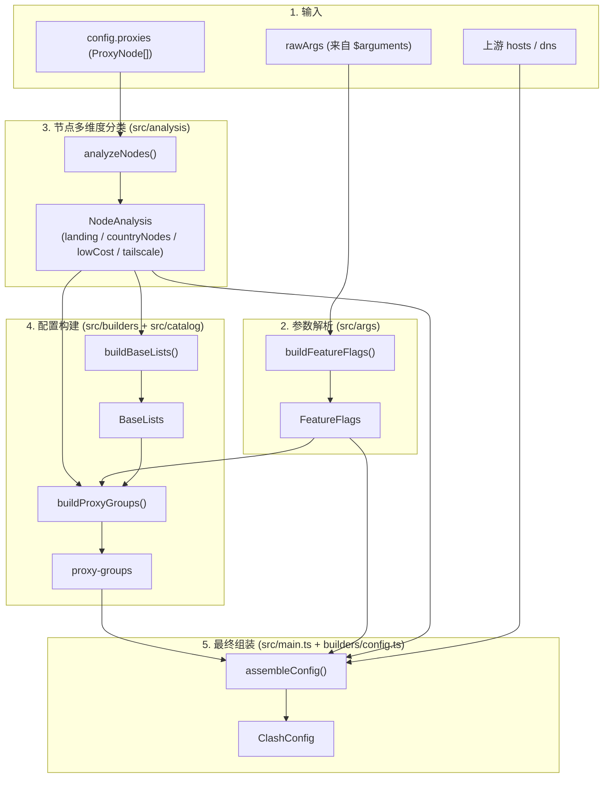

# override-rules 架构文档

本项目是一个 Mihomo/Clash 订阅覆写脚本。它拦截上游订阅配置中的代理节点，按落地/非落地、国家和地区进行多维度分类，并按照预设的规则与策略组将其重组为优化后的 Clash 配置——包含代理组、路由规则、DNS 及 TUN 支持。

源码采用「声明式数据 / 纯构建逻辑 / 组装入口」三层结构：`catalog/` 存放可独立修改的数据，`builders/` 存放不持有状态的纯函数，`main.ts` 只做流程编排。

---

## 数据流概览

整个覆写脚本的核心流程分为五个阶段：**输入** → **参数解析** → **节点分类** → **配置构建** → **最终组装**。

### 各阶段职责

| 阶段 | 核心模块 | 职责 |
|------|----------|------|
| 输入 | — | 上游订阅传入的代理节点列表 (`config.proxies`)、可继承的 `hosts`/DNS 字段与用户提供的 URL 覆写参数 (`$arguments`) |
| 参数解析 | `src/args/` | 将原始字符串参数转换为类型安全的 `FeatureFlags` 对象；默认值集中在 `schema.ts` |
| 节点分类 | `src/analysis/` | 将节点按落地/非落地、所属国家/地区、低价节点和 Tailscale 类型分类；按阈值提取活跃国家名称 |
| 配置构建 | `src/builders/` + `src/catalog/` | 先生成基础代理选择列表 (`BaseLists`)，再按声明式目录生成服务组、条件组、国家/地区组和 Tailscale 组 |
| 最终组装 | `src/main.ts` + `src/builders/config.ts` | 将原始节点、代理组、规则、Rule Provider、DNS、TUN、Geo 数据源及必要的上游字段拼装为最终 `ClashConfig` |

---

## 文件职责

| 文件 | 职责 | 关键导出 |
|------|------|----------|
| `src/main.ts` | 覆写脚本入口（banner、`globalThis.main` 契约、流程编排） | `main()` |
| `src/types/args.ts` | 参数与功能开关类型 | `ScriptArgs`, `FeatureFlags`, `GroupType` |
| `src/types/proxy.ts` | 代理节点、代理组、分类结果类型 | `ProxyNode`, `ProxyGroup`, `NodeAnalysis`, `GroupBuildContext` 等 |
| `src/types/clash.ts` | Clash 配置结构类型 | `ClashConfig`, `DnsConfig`, `TunConfig`, `SnifferConfig`, `RuleProvider` |
| `src/args/schema.ts` | URL 参数默认值的唯一来源 | `ARG_DEFAULTS` |
| `src/args/parse.ts` | URL 参数解析与默认值回填 | `buildFeatureFlags()` |
| `src/catalog/endpoints.ts` | CDN 与测速端点 | `CDN_URL`, `SPEEDTEST_URL` |
| `src/catalog/icons.ts` | 代理组图标集中定义 | `ICONS` |
| `src/catalog/group-names.ts` | 代理组名称与命名辅助 | `PROXY_GROUPS`, `NODE_SUFFIX`, `countryGroupName()` |
| `src/catalog/countries.ts` | 国家/地区元数据；派生匹配正则 | `countriesMeta`, `countryRegexMap`, `countryExcludeRegexMap` |
| `src/catalog/low-cost.ts` | 低倍率节点匹配器 | `LOW_COST_NODE_MATCHER` |
| `src/catalog/service-groups.ts` | 服务代理组的声明式目录 | `serviceGroups` |
| `src/catalog/rule-sets.ts` | Rule Provider 注册表（强类型键） | `ruleSets`, `RuleSetKey`, `ruleSet()` |
| `src/analysis/classify.ts` | 节点多维度分类 | `analyzeNodes()` |
| `src/analysis/active-countries.ts` | 地区阈值过滤与权重排序 | `getActiveCountryNames()` |
| `src/domain/proxy-group.ts` | 代理组构造工厂（字段顺序与空候选兜底集中管理） | `buildGroupByType()`, `selectGroup()`, `urlTestGroup()`, `fallbackGroup()` |
| `src/builders/selectors.ts` | 各策略组的基础候选列表 | `buildBaseLists()` |
| `src/builders/proxy-groups.ts` | 代理组组装（前置/服务/尾部/地区） | `buildProxyGroups()` |
| `src/builders/rules.ts` | 路由规则构建 | `buildRules()` |
| `src/builders/rule-set` 引用 | 规则集名称受 `RuleSetKey` 约束，改名可编译期报错 | — |
| `src/builders/dns.ts` | DNS 配置、fake-ip 过滤与上游字段继承 | `buildDns()` |
| `src/builders/sniffer.ts` | 域名嗅探配置 | `snifferConfig` |
| `src/builders/tun.ts` | TUN 模式配置 | `buildTunConfig()` |
| `src/builders/full-config.ts` | `full=true` 时追加的完整内核参数 | `buildFullConfig()` |
| `src/builders/geox.ts` | GeoIP/GeoSite/MMDB/ASN 数据源地址 | `geoxUrl` |
| `src/builders/config.ts` | 最终配置组装（含 GLOBAL 组追加） | `assembleConfig()` |
| `src/utils/primitives.ts` | 通用工具函数 | `buildList()`, `parseBool()`, `parseNumber()`, `isNotNull()` |
| `src/utils/regex.ts` | 正则匹配工具 | `createCaseInsensitiveNodeMatcher()` |
| `scripts/yaml_generator/generator.ts` | 静态 YAML 覆写文件生成器 | 穷举参数组合，生成 `yamls/` 目录下的 192 个 YAML 配置文件；支持 `LIMIT_COMBOS` 限制生成数量 |
| `tests/` | 轻量单元测试（`node --import tsx --test`） | 覆盖参数解析、节点分类、代理组构造、规则/DNS/TUN、最终组装 |

---

## 设计决策

### 模块化与「改一处不影响别处」

- **声明式数据与逻辑分离**：新增/调整一个服务代理组，只需在 `catalog/service-groups.ts` 增加一条记录，无需改动组装逻辑；调整图标只需改 `catalog/icons.ts`；调整参数默认值只需改 `args/schema.ts`。
- **规则集强类型**：`rules.ts` 中所有 `RULE-SET` 引用都通过 `ruleSet(key, target)` 生成，`key` 受 `RuleSetKey` 约束，规则集改名或拼写错误会在编译期报错。
- **字段顺序集中管理**：代理组的键插入顺序决定 YAML 输出顺序，因此各类代理组的字段顺序统一由 `domain/proxy-group.ts` 的工厂函数保证，测试中亦有断言锁定。
- **空代理组兜底集中管理**：`selectors.ts` 只负责生成候选列表，允许出现空列表；`domain/proxy-group.ts` 的 `normalizeNodeSource()`（以及经其处理的 `buildGroupByType()`）在既无显式 `proxies` 又未启用 `include-all` 时统一补入 `DIRECT`，确保最终不会输出空组。
- **类型按域拆分**：`types/args.ts`、`types/proxy.ts`、`types/clash.ts` 各自独立，避免单文件成为全局改动的耦合点。

### 落地/非落地自动检测

`dialer-proxy` 在 Clash 链式代理中表示当前节点通过指定代理拨号。脚本据此自动区分：

- 包含 `dialer-proxy: "前置代理"` 字段的节点 → **落地节点**（目标/出口节点），归入「落地节点」组
- 其余所有节点 → **非落地节点**（中继/普通节点），归入国家地区分组和「前置代理」组

变量 `landing` 为 `true` 当且仅当存在落地节点（`landingNodes.length > 0`）。只要出现落地节点，就会生成「落地节点」与「前置代理」组；全落地时地区分类为空，「前置代理」组仅保留 `DIRECT`。地区与低倍率分类始终只扫描非落地节点。

### 节点分类

节点在进入配置构建阶段前，由 `analyzeNodes()` 经过四个独立维度的分类，产出一个 `NodeAnalysis`：

1. **落地/非落地** — 决定节点归属的代理组类型。当 `landing = true` 时，后续的国家和低价节点分类只扫描非落地节点（即落地节点不参与按国家分发）。
2. **国家/地区** — 通过正则匹配节点名称中的地理位置关键字，将节点归入对应的国家/地区分组。匹配规则定义在 `countriesMeta` 中。
3. **低价节点** — 匹配特定正则 (`LOW_COST_NODE_MATCHER`) 的节点归入低价策略组，供用户按需选用。
4. **Tailscale** — `type: "tailscale"` 的节点单独归入 Tailscale 代理组；只有检测到此类节点时才生成该组及对应的规则。该组默认 `hidden: true`，且 Tailscale 节点不参与国家/低价分类与常规候选列表。

这些分类维度相互独立，构建阶段通过组合它们来生成完整的代理组树。

分类结果还会派生 `regionLayout`：通过 `threshold` 的地区数 ≥ 2 时为 `grouped`，为每个地区生成 `${地区}节点` 组，并保留「手动选择」组；不足 2 个时为 `flattened`，不生成任何地区组，`选择代理`、`自动选择`、`故障转移` 直接引用非落地节点（不含 Tailscale），同时不再生成与 `选择代理` 高度重合的「手动选择」组。服务组同样按 `regionLayout.groupedCountries` 判断目标地区组是否存在，避免引用已展平的地区组；展平模式下服务组的 `defaultProxies` / `defaultProxiesDirect` 也不再引用 `选择代理`，而是直接携带同一份展平节点来源。若存在「低倍率节点」组，「静态资源」组会将其置于候选首位，其余候选保持正常顺序。

### Tailscale 集成

当订阅中存在 `type: "tailscale"` 的节点时，脚本会：

- 创建只包含 Tailscale 节点的「Tailscale」代理组（默认 `hidden: true`）；
- 将 Tailscale 节点从「手动选择」、展平模式下的 `选择代理` / `自动选择` / `故障转移` / 服务组、地区组、低倍率组及「前置代理」等常规候选中排除（`regex=true` 时通过 `exclude-filter` 排除）；
- 为 `100.64.0.0/10`、`fd7a:115c:a1e0::/48` 和 `ts.net` 添加定向分流规则；
- Tailscale 存在时不排除对应地址段，使其能够交由 Tailscale 代理组处理；不存在时则排除这些地址段，避免无效的路由进入 TUN。

没有 Tailscale 节点时，上述代理组和分流规则不会生成；TUN 仍输出统一的基础配置，并额外排除 Tailscale 地址段与局域网地址段。

### 数据流

- **分类结果即唯一数据源**：`analyzeNodes()` 一次性返回 `NodeAnalysis`，后续构建阶段不再回读 `config.proxies`，保证判定依据可追溯。
- **`NODE_SUFFIX` 仅在展示层添加**：`"节点"` 后缀（如「香港」→「香港节点」）只在 `buildBaseLists()` 与 `buildProxyGroups()` 中通过 `countryGroupName()` 拼接，分类层完全不涉及此概念。
- **数据优于标志**：接收节点信息的参数统一使用具体数据（如 `landingNodes: ProxyNode[]`、`countryNodes: Record<string, ProxyNode[]>`）而非布尔值；布尔标志（如 `landing`）由数据推导得出。

### args 的默认值

所有 URL 参数都有明确的默认值，集中在 `src/args/schema.ts` 的 `ARG_DEFAULTS`，由 `buildFeatureFlags()` 解析并回填。当前默认值包括：

- `grouptype=1`（`url-test`）；若未指定 `grouptype`，仍兼容旧的 `loadbalance` 参数；
- `fakeip=true`；
- `threshold=2`，少于两个节点的地区不会生成地区组；过滤后不足 2 个地区时整体展平；
- `ipv6`、`full`、`keepalive`、`quic`、`regex`、`tun` 默认关闭。

布尔参数接受 `true`/`false` 和 `1`/`0` 形式。

### 上游配置继承

脚本不会无条件覆盖上游配置的全部字段：

- 始终保留上游 `hosts`；
- 在生成 DNS 配置后，合并上游的 `nameserver-policy`、`proxy-server-nameserver-policy` 和 `fake-ip-filter`；
- 脚本生成的 DNS 核心设置（如增强模式、IPv6 开关和默认 DNS 列表）保持优先级。

这样既能维持脚本的统一 DNS 行为，也能保留订阅提供方针对特定域名的策略。

### YAML Generator 的参数

静态 YAML 配置文件通过 `scripts/yaml_generator/generator.ts` 穷举参数组合生成：

| 参数 | 可选值 | 数量 |
|------|--------|------|
| `ipv6` | true / false | 2 |
| `full` | true / false | 2 |
| `keepalive` | true / false | 2 |
| `fakeip` | true / false | 2 |
| `quic` | true / false | 2 |
| `tun` | true / false | 2 |
| `grouptype` | select / url-test / load-balance | 3 |

共计 2⁶ × 3 = 192 个 YAML 文件。`landing` 不在 FLAGS 中——YAML 生成器使用 `fake_proxies.json` 中的模拟节点数据自动判定。生成时固定启用 `regex: true`，因为静态配置无法预知实际订阅的节点名称。模拟数据覆盖多个地区，因此静态 YAML 产物仍走分组模式；展平分支由单元测试覆盖。

---

## 输出模式

本项目支持两种部署方式，分别适用于不同使用场景：

### JS 动态覆写（convert.js）

**主要模式。** 运行于 Substore 等订阅转换工具的脚本执行环境（如 Loon、Surge 的脚本功能）。脚本动态分析上游订阅传入的**真实代理节点列表**，根据节点名称中的地理位置关键字和属性字段（如 `dialer-proxy`）实时分类，并生成包含完整代理组、规则、DNS 及 TUN 配置的 Clash 配置。

这是推荐的使用方式，原因在于：

- 节点分类结果始终反映当前订阅的实际状态，新增或失效的节点会自动归入对应分组
- 代理组可直接枚举具体节点名称（`regex: false`），比正则过滤更精确
- 支持完整的运行时参数覆盖（通过 URL hash 传参）

### 静态 YAML 覆写（yamls/*.yaml）

**备用模式。** 通过 `scripts/yaml_generator/generator.ts` 预先生成的 YAML 配置文件，存放在 `yamls/` 目录下。这些文件使用 `scripts/yaml_generator/fake_proxies.json` 中的模拟节点数据穷举所有参数组合生成，供无法运行 JS 脚本的客户端直接引用。

YAML 模式的特点：

- 地区组使用正则过滤（`include-all` + `filter`），「手动选择」组使用 `include-all`，而非枚举具体节点名称——这是静态文件无法预知真实节点列表的必然选择
- 所有参数组合已预编译，用户只需选择对应的 YAML 文件 URL
- 不依赖脚本运行时，兼容性最广

两种模式共享同一套 `src/catalog/` 与 `src/builders/` 逻辑，区别仅在于运行时的数据来源和过滤方式。